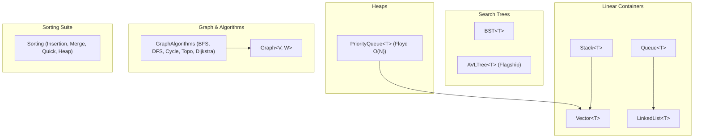

# DSA Core C++17

[](https://github.com/GodsGreatness/dsa-core-cpp/actions/workflows/ci.yml)
[](https://en.wikipedia.org/wiki/C%2B%2B17)
[](LICENSE)
[]()
[]()

A production-quality, generic **C++17** implementation of fundamental data structures and algorithms, featuring rigorous correctness testing, recursive invariant validation, empirical asymptotic scaling benchmarks, and automated multi-compiler CI with memory sanitizers (**ASan + UBSan**).

---

## ⚡ Core Features

- **Genuine Modern C++ Generic Engineering:**
  - Strict **Rule of Five** conformance (Copy/Move constructors, Copy/Move assignments, Destructors).
  - Perfect forwarding `emplace_back` and `emplace` operations.
  - Raw uninitialized storage allocation for `Vector<T>` (never forces redundant default construction).
  - Move-only type support (`std::unique_ptr<T>`) across all containers.
  - Exception safety: strong guarantees via copy-and-swap and `std::move_if_noexcept`.
- **Flagship Self-Balancing AVL Tree:**
  - Strict balance factor invariant: $|height(left) - height(right)| \le 1$.
  - Isolated rotation unit testing ($LL, RR, LR, RL$) and randomized 5,000-key stress tests.
  - Automated recursive invariant verification (`verifyInvariants()`).
- **Graph & Shortest Path Suite:**
  - Dual support for **Directed** and **Undirected** graphs.
  - BFS, DFS, cycle detection (3-color DFS), and topological sort (Kahn's algorithm).
  - **Dijkstra's Shortest Path:** Enforces non-negative edge weight constraints and throws `std::invalid_argument` upon negative edges.
- **Algorithmic Sorting Family:**
  - Insertion Sort, Merge Sort (stable), Quick Sort (median-of-3 + hybrid insertion fallback), and Heap Sort.
- **Empirical Scaling Benchmarks:**
  - Evaluates real execution scaling across orders of magnitude ($N = 10^3 \to 10^5$) demonstrating empirical logarithmic vs linear curves.
- **Production CI & Sanitizers:**
  - Automated GitHub Actions matrix testing **GCC**, **Clang**, and **MSVC (Windows)**, plus dedicated **AddressSanitizer (ASan) and UndefinedBehaviorSanitizer (UBSan)** runs.

---

## 🏛️ Architecture Overview



---

## 📊 Empirical Scaling Benchmarks

Empirical performance measured on benchmark targets compiled with `-O2`:

### 1. Search Time: Tree Search ($O(\log N)$) vs Linear Search ($O(N)$)
*Batch query workload: 1,000 random lookup queries across varying container sizes.*

| Scale ($N$) | AVL Search ($O(\log N)$) | BST Search ($O(\log N)$) | Vector Linear Search ($O(N)$) |
| :---: | :---: | :---: | :---: |
| **$1,000$** | **$51.00\ \mu s$** | $56.00\ \mu s$ | $269.00\ \mu s$ |
| **$10,000$** | **$119.00\ \mu s$** | $118.00\ \mu s$ | $3,230.00\ \mu s$ |
| **$50,000$** | **$176.00\ \mu s$** | $207.00\ \mu s$ | $14,205.00\ \mu s$ |
| **$100,000$** | **$353.00\ \mu s$** | $393.00\ \mu s$ | **$25,778.00\ \mu s$** |

> Notice the scaling: at $N = 100,000$, `AVLTree` completes 1,000 queries in **$353\ \mu s$**, while linear search takes **$25,778\ \mu s$** ($73\times$ faster).

---

### 2. Sorting Scaling: Quadratic ($O(N^2)$) vs Log-Linear ($O(N \log N)$)

| Scale ($N$) | Insertion Sort ($O(N^2)$) | Merge Sort ($O(N \log N)$) | Quick Sort ($O(N \log N)$) | Heap Sort ($O(N \log N)$) |
| :---: | :---: | :---: | :---: | :---: |
| **$1,000$** | $0.12\text{ ms}$ | $0.12\text{ ms}$ | $0.03\text{ ms}$ | $0.03\text{ ms}$ |
| **$5,000$** | $2.88\text{ ms}$ | $0.56\text{ ms}$ | $0.18\text{ ms}$ | $0.14\text{ ms}$ |
| **$10,000$** | $11.57\text{ ms}$ | $1.20\text{ ms}$ | $0.38\text{ ms}$ | $0.31\text{ ms}$ |
| **$25,000$** | **$70.82\text{ ms}$** | **$3.48\text{ ms}$** | **$1.09\text{ ms}$** | **$0.84\text{ ms}$** |

---

## 📈 Asymptotic Complexity Cheat Sheet

| Data Structure / Algorithm | Access | Search | Insertion | Deletion | Space |
| :--- | :---: | :---: | :---: | :---: | :---: |
| **`Vector<T>`** | $O(1)$ | $O(n)$ | $O(1)^*$ | $O(1)$ | $O(n)$ |
| **`LinkedList<T>`** | $O(n)$ | $O(n)$ | $O(1)$ | $O(1)$ | $O(n)$ |
| **`Stack<T>`** | $O(1)$ | $O(n)$ | $O(1)$ | $O(1)$ | $O(n)$ |
| **`Queue<T>`** | $O(1)$ | $O(n)$ | $O(1)$ | $O(1)$ | $O(n)$ |
| **`BST<T>`** | — | $O(\log n)$ | $O(\log n)$ | $O(\log n)$ | $O(n)$ |
| **`AVLTree<T>`** | — | **$O(\log n)$** | **$O(\log n)$** | **$O(\log n)$** | $O(n)$ |
| **`PriorityQueue<T>`** | $O(1)$ (top) | — | $O(\log n)$ | $O(\log n)$ | $O(n)$ |
| **BFS / DFS** | — | — | — | — | $O(V + E)$ |
| **Dijkstra** | — | — | — | — | $O((V + E) \log V)$ |
| **Merge / Quick / Heap Sort** | — | — | — | — | $O(n \log n)$ |

*Detailed Big-O derivations and edge cases are documented in [docs/complexity.md](docs/complexity.md).*

---

## 🌲 Flagship: AVL Tree Invariant Verification

Unlike basic tutorials that only verify sequential insertions, `dsa::AVLTree` enforces balance invariants through recursive mathematical validation:

```cpp
// Check: |height(left) - height(right)| <= 1 at every node
bool isValid = avl.verifyInvariants();
```

### Self-Balancing Rotations Implemented:
* **Single Right Rotation ($LL$):** Triggered when an insertion occurs in the left subtree of the left child.
* **Single Left Rotation ($RR$):** Triggered when an insertion occurs in the right subtree of the right child.
* **Double Left-Right Rotation ($LR$):** Left rotate on left child, then right rotate on node.
* **Double Right-Left Rotation ($RL$):** Right rotate on right child, then left rotate on node.

Every rotation preserves memory safety through `std::unique_ptr<Node>` ownership transfer without raw pointer leaks.

---

## 🛠️ Build & Test Instructions

### Prerequisites
* C++17 compliant compiler (`g++`, `clang++`, or `MSVC`)
* GNU Make or CMake (>= 3.15)

### One-Click Automated Runners:
```bash
# Run all 9 unit test suites:
powershell scripts/run_tests.ps1        # Windows
bash scripts/run_tests.sh               # Linux / macOS

# Run empirical scaling benchmarks:
powershell scripts/run_benchmarks.ps1   # Windows
bash scripts/run_benchmarks.sh          # Linux / macOS
```

### Using Make:
```bash
# Build demo, unit tests, benchmarks, and examples
make all

# Run complete unit test suite (9 test suites)
make test

# Run empirical benchmark suite
make benchmark
```

### Using CMake:
```bash
cmake -B build -DCMAKE_BUILD_TYPE=Release
cmake --build build --config Release
ctest --test-dir build --output-on-failure
```

---

## 📁 Repository Structure

```text
dsa-core-cpp/
├── .github/
│   └── workflows/
│       └── ci.yml               # Multi-platform CI + ASan/UBSan sanitizers
├── docs/
│   ├── complexity.md            # Complete Big-O time and space cheat sheet
│   ├── architecture.md          # RAII principles, memory layout, Rule of 5
│   └── design-decisions.md      # Engineering trade-offs & design choices
├── include/
│   └── dsa/
│       ├── linear/
│       │   ├── Vector.hpp       # Contiguous raw-allocated dynamic array
│       │   ├── LinkedList.hpp   # Doubly-linked list with sentinel nodes
│       │   ├── Stack.hpp        # LIFO adapter
│       │   └── Queue.hpp        # FIFO adapter
│       ├── trees/
│       │   ├── BST.hpp          # Binary Search Tree
│       │   └── AVLTree.hpp      # Self-Balancing AVL Tree (Flagship)
│       ├── heap/
│       │   └── PriorityQueue.hpp# Binary Heap with Floyd's O(N) heapify
│       ├── graph/
│       │   └── Graph.hpp        # Adjacency list (Directed & Undirected)
│       └── algorithms/
│           ├── GraphAlgorithms.hpp # BFS, DFS, Cycle, TopoSort, Dijkstra
│           └── Sorting.hpp      # Insertion, Merge, Quick, Heap Sort
├── tests/
│   ├── test_vector.cpp
│   ├── test_linked_list.cpp
│   ├── test_stack.cpp
│   ├── test_queue.cpp
│   ├── test_bst.cpp
│   ├── test_avl.cpp
│   ├── test_heap.cpp
│   ├── test_graph.cpp
│   └── test_sorting.cpp
├── benchmarks/
│   ├── benchmark_linear.cpp
│   ├── benchmark_trees.cpp
│   └── benchmark_sorting.cpp
├── examples/
│   ├── vector_example.cpp
│   ├── avl_example.cpp
│   └── graph_example.cpp
├── scripts/
│   ├── run_tests.ps1            # One-click Windows PowerShell test suite runner
│   ├── run_tests.sh             # One-click Linux/macOS test suite runner
│   ├── run_benchmarks.ps1       # One-click Windows PowerShell benchmark runner
│   └── run_benchmarks.sh        # One-click Linux/macOS benchmark runner
├── src/
│   └── main.cpp                 # Library demonstration CLI
├── .clang-format                # Google C++ style formatting
├── .clang-tidy                  # Static analysis & linter checks
├── Makefile
├── CMakeLists.txt
├── LICENSE                      # MIT License
└── README.md
```

---

## 📄 License
This project is open-source under the [MIT License](LICENSE).
